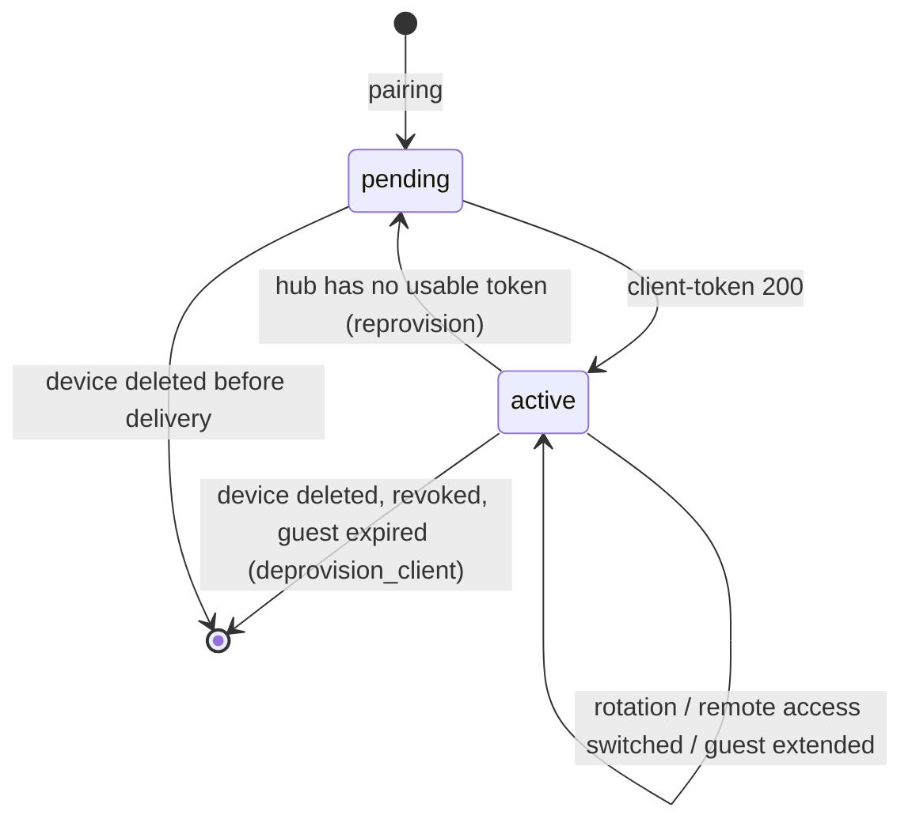
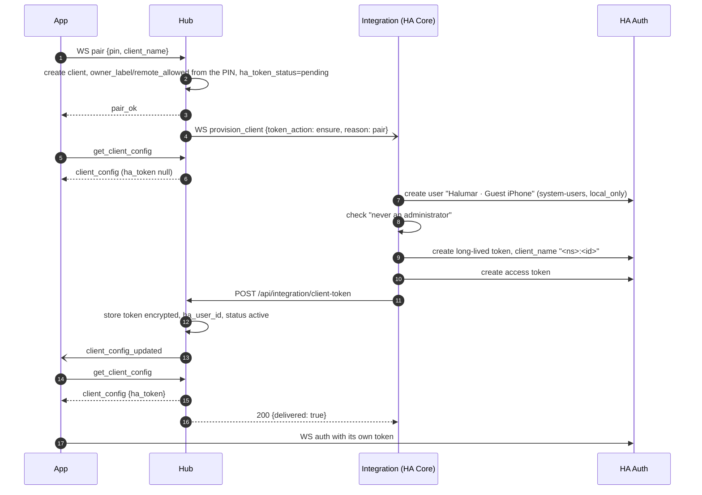
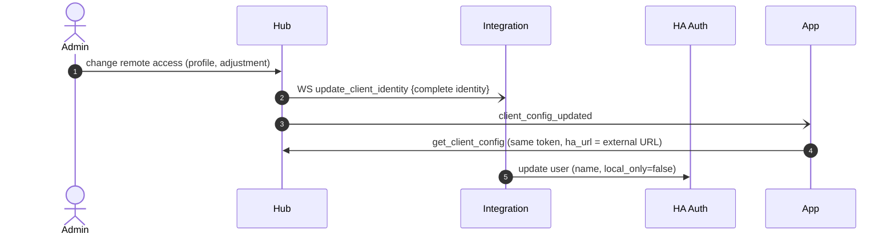
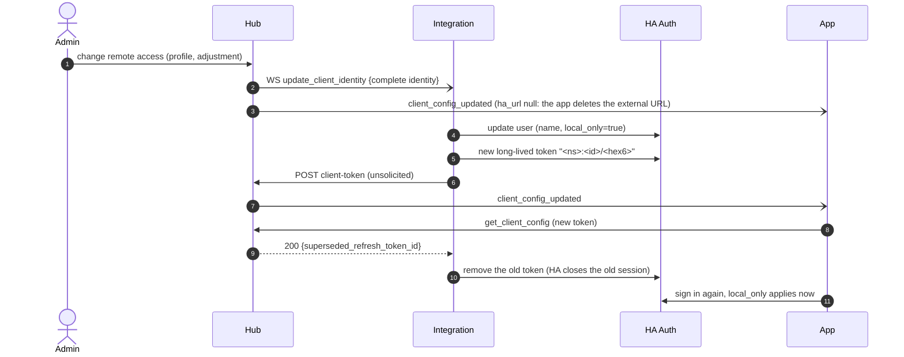
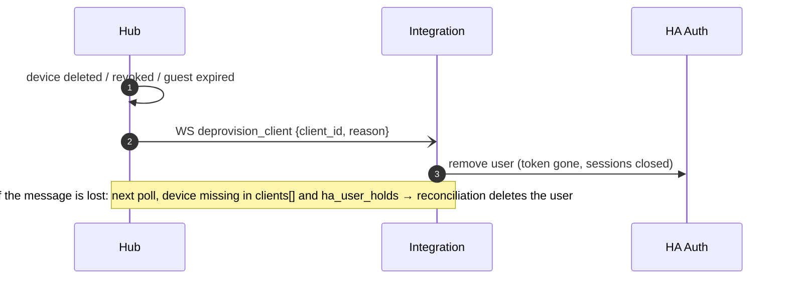

# One Home Assistant user per device

Part of protocol 1.

Every paired device gets its own Home Assistant user with exactly one long-lived access token.
Device, Home Assistant user and token are 1:1:1. The **integration** creates the user and the token in
Home Assistant (only it can, because it runs inside Home Assistant Core); the **hub** stores the token
and hands it to the app in `client_config`.

Which group the user is in depends on the device's control path: a new user starts in
`system-users` and moves to `system-read-only` with its first rule snapshot when the path is
`checked` or `hub` ([enforcement.md](enforcement.md#1-control-path)). On Hub only without remote access
the hub keeps the token and never hands it to the app.

## 1. Contract parts

| Part | File | Direction |
|---|---|---|
| WS `provision_client` | `schemas/ws/integration/provision_client.json` (data: `schemas/common/provision-request.json`) | hub → integration |
| WS `update_client_identity` | `schemas/ws/integration/update_client_identity.json` (data: `schemas/common/client-identity.json`) | hub → integration |
| WS `deprovision_client` | `schemas/ws/integration/deprovision_client.json` | hub → integration |
| REST `POST /api/integration/client-token` | `schemas/integration/client-token.{request,response,error}.json` | integration → hub |
| Status snapshot: `clients[].ha_user_id`, `ha_token_status`, `owner_label`, `remote_allowed`, `provisioning[]`, `ha_user_holds` | `schemas/integration/status.response.json` | hub → integration |
| `ha_token_status`: `pending`, `active` | `schemas/common/defs.json#/$defs/ha_token_status` | – |
| Admin API: `owner_label`, `remote_allowed`, `ha_user_id`, `ha_token_status` | `schemas/rest/paired-client.json`, `client-update.request.json`, `pairing-generate.request.json`, `openapi/hub.openapi.json` | admin UI ↔ hub |
| Pairing started through the integration: `owner_label`, `remote_allowed` | `schemas/integration/start-pairing.request.json` | integration → hub |
| `client_name` of the device tokens `<ns>:<client_id>` (after a rotation `<ns>:<client_id>/<hex6>`) | `namespace.json` (`ha_device_token_client_name_prefix`) | – |

The hub itself creates no Home Assistant tokens and holds no owner token.

## 2. Transport between integration and hub

- The integration keeps a WebSocket session to the hub open as soon as the status snapshot reports
  `hub.ws_push`. The hub can therefore send `provision_client` to it without a new connection.
- The session is **read-only** for the integration. Answers go over REST
  (`POST /api/integration/client-token`). Update and deprovision have no answer.
- If a push is lost (connection gone, message lost, Home Assistant restart), the **poll** catches it:
  `GET /api/integration/status` carries `provisioning[]` (open requests, the same shape as
  `provision_client.data`) and, in `clients[]`, the target state of every identity. The integration
  reconciles on every successful poll.
- The hub does not learn directly that an update or a deprovision succeeded. This is intended: both
  are state based, and the integration reconciles on every poll.

## 3. Semantics and idempotency

| Message or call | The integration | Received twice |
|---|---|---|
| `provision_client`, `token_action: ensure` | creates the user or reuses it (mapping `client_id → user_id` is persistent), aligns name and `local_only`, reuses an existing long-lived token, derives a new access token from it, sends `client-token` | same `refresh_token_id`, the hub answers `unchanged: true` |
| `provision_client`, `token_action: rotate` | creates a new long-lived token for the same user, sends `client-token`, removes every other token of the user after the 200 | a second rotation creates another token; the hub drops the request from `provisioning[]` after the first delivery |
| `update_client_identity` | updates name and `local_only`. It rotates the token on its own (unsolicited delivery to `client-token`) only when remote access is **withdrawn** (`local_only` false → true, so open sessions from outside end) or a guest token no longer covers the expiry. **Granting** remote access keeps the token (it works from away at once). A `local_only` set by hand on a device with remote access is set back without a new token | complete identity, no diff |
| `deprovision_client` | removes the user (Home Assistant removes the token and closes open sessions) | user already gone: nothing to do |
| Poll | works through `provisioning[]`, aligns identities from `clients[]`, deletes device users without an active device, **except** those whose `client_id` is in `ha_user_holds` | state based |

Rules that always hold:

1. **Never an administrator.** Before every token the integration checks: not the owner, not an
   administrator, not system generated, no login credentials, group `system-users` or
   `system-read-only`. If the check fails, no token is created. Without an existing Home Assistant
   owner no device user is created (Home Assistant would otherwise make the first user the owner).
2. **Remote access follows the profile.** `local_only` = not `remote_allowed`, the effective rule
   `remote_access`; guests have remote access only when their profile allows it. Token lifetime of
   guests: expiry plus 7 days; an extension beyond that rotates the token.
3. **New token first.** Deliver the new token, wait until the hub confirms (after the app fetched its
   configuration or 5 s passed, plus 3 s), only then remove the old token.
4. **Reconciliation deletes only its own users:** users in the integration's mapping or clearly marked
   (all tokens are long-lived tokens with `client_name` `<ns>:<client_id>…`), and never the owner, an
   administrator, system-generated users or users with login credentials. Nothing is deleted when the
   snapshot is capped (more than 500 clients), when the user was created after the poll started, or
   when its `client_id` is in `ha_user_holds` (below).
5. The bearer token is never stored in plain text or logged, by the integration or the hub; only ids
   are.

### Errors and retries of `POST /api/integration/client-token`

| Answer | Integration |
|---|---|
| 200 | marks the mapping as delivered, removes surplus tokens |
| 404 `client_not_found`, 409 `client_inactive` | deletes the device user |
| 401 / 403 | the integration token was rotated; Supervisor rediscovery repairs it, then the next poll |
| 422 | logs the error (a bug); `request_required`: a delivery for another Home Assistant user without an open request – keep the user, the next request repairs it |
| 503, network error, timeout | deletes nothing; the hub keeps the device in `provisioning[]`, the next poll tries again with the same `refresh_token_id` |

**Binding.** The hub accepts a token only while the device waits for it (`pending`), with the
`request_id` of an open rotation, or unsolicited for the Home Assistant user already stored for the
device. Under the Supervisor the hub accepts the integration token only from its own host (Home
Assistant Core connects host-internally), never from the LAN or other apps, even if it comes from a
Home Assistant backup.

The hub repeats `provision_client` as a push at most every 60 s per device (backoff up to 15 minutes)
while the device is `pending`.

## 4. States of `ha_token_status`

## 5. Flows

### 5.1 Pairing

For a device on Hub only or Checked the hub pushes the rule snapshot first, so the user is read-only
before the app gets the token ([enforcement.md](enforcement.md#1-control-path)). A device on Hub only
never gets the token unless its profile allows remote access; then it gets the read-only key
([enforcement.md §7](enforcement.md#7-devices-on-the-hub-path)). The hub holds the token either way and
uses it for the device's calls on the hub path.

### 5.2 Switching remote access, renaming, rotation

Granting remote access creates no new token. Home Assistant checks `local_only` at every sign-in, so
the existing token works from away at once, also for a device that is away right now. The hub sends the
device `client_config_updated`; `client_config.ha_url` now holds the external URL (only devices whose
effective rule `remote_access` is on, guests included). A device on Hub only gets the token the hub
already holds at the same time (a read-only key).

Withdrawing remote access: `local_only` on and a rotation, so open sessions from outside end at once.

If the device is away at that moment, its old token fails. The hub reports a signed
`need_token_update` on the compliance channel as long as the token changed after the device's last hub
contact; the app then stops signing in from outside (to avoid an IP ban in Home Assistant) and fetches
the new token on the home network.

An admin rotation (`POST /api/clients/{id}/rotate-token`, `schemas/rest/rotate-token.response.json`)
runs the same way, started with `provision_client {token_action: rotate}`. The hub stores the
rotation first (it survives a restart) and answers:

| Answer | Meaning |
|---|---|
| 200 | new token delivered within the waiting time (`ha_token_status`, `ha_token_minted_at`) |
| 202 `status: rotation_requested` | sent to the integration, the answer is still pending |
| 202 `status: pending` | the integration is not connected; the rotation runs once it is. Immediate answer, no waiting. **Also** for a device with remote access that is not connected to the hub (away): the rotation waits until it connects to the hub (then it is on the home network and fetches the new token at once), at most 72 hours, then it runs anyway (audit log). The admin UI tells this case apart by `remote_allowed` and `is_connected` |
| 404 / 409 | device unknown / not active or still without a token |

### 5.3 Removing

**Deleting with a hold (`ha_user_holds`).** A deleted device keeps its Home Assistant user until its
app confirms the reset (`client_removed` → `client_reset_ack`) or the hold ends: online the reset
acknowledgement window (a few seconds), offline 24 hours (survives hub restarts). A returning app
therefore never fails on a deleted token but is reset cleanly first. While the hold runs, the
`client_id` is listed in `ha_user_holds` of the status snapshot and the integration does not delete
that user. When the hold ends (acknowledgement, timeout, admin force purge) the hub sends
`deprovision_client`. **Revoking** (lost or stolen device) removes the user at once, without a hold.

**Choice when deleting an offline device**:
`DELETE /api/pairing/clients/{client_id}/permanent?ha_user_removal=on_reconnect|immediate`. It applies
only when the device is **not connected**; a connected device always gets `client_removed` and the
reset acknowledgement window.

| `ha_user_removal` | Effect (offline) |
|---|---|
| `on_reconnect` | the Home Assistant user stays (`ha_user_holds`) until the app returns and confirms the reset, at most 24 hours. The app returns cleanly to setup |
| `immediate` | the Home Assistant user is removed at once (`deprovision_client`); the tombstone stays, so the returning app is still reset through the hub, though its Home Assistant sign-in may fail once before that |
| missing | default: `immediate` for devices with remote access (`remote_allowed`), else `on_reconnect` |

Unknown values: 422. Guests are not deleted but ended (`kick`). Lost or stolen devices: **revoke**
(`DELETE /api/pairing/clients/{client_id}`), which always acts at once: connection closed, Home
Assistant user gone, the row stays as "revoked" (`is_active: false`, the app gets `auth_error`
`revoked`). Removing it from the list afterwards works like deleting (`…/permanent`, tombstone).
